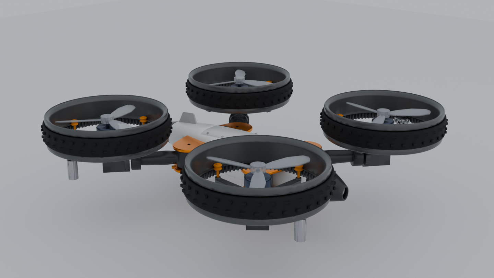

# CF-2 Chameleon-Ring

A morphing quadcopter-rover concept for university research. Each of the four rotor-guard rings is also a drive wheel: a two-joint arm module (J1 arm yaw, J2 pod roll) turns a ring from a horizontal duct into a vertical wheel.



Three modes:

| Mode | Pose | What it does |
|---|---|---|
| Normal flight | arms 50 / 130 deg, pods level | rings act as ducts around the propellers |
| Rover | arms flat 0 / 180 deg, pods rolled 90 deg | rings roll on the ground, each driven by its own motor |
| Speed | arms 75 / 105 deg, pods rolled 90 deg | all four thrust vectors point forward |

Non-weaponised research platform. Concept stage.

## Status

Everything in this repository is a design and a calculation. Nothing has been built, printed or flown.

- **Done:** parametric CAD, per-part STEP/STL, exact clearance checks for the poses and transformation paths, mass and CG estimate, Rev C parts list and budget, first-principles performance estimates, an interactive 3D model and an animated overview.
- **Not done:** CFD, multibody or flight simulation, structural analysis, firmware, printed parts, any physical test. The Fusion build script has never been run in Fusion.
- **Weakest part:** speed mode. The wing is not modelled, and the rear rings fly in the wake of the front pair.
- **Known mismatch:** the CAD still uses placeholder motor, servo and electronics sizes. The Rev C servos, ESC and companion computer do not fit the current arm and bays.
- All performance figures are estimates. See `docs/performance-estimates.md` for assumptions.

## Layout

| Folder | Contents |
|---|---|
| [`cad/`](cad) | CadQuery source (`params.py` and generators), STEP and STL exports, FreeCAD document, Fusion build script |
| [`docs/`](docs) | Design notes, operating modes and transformation, performance estimates, validation register, test plan |
| [`bom/`](bom) | Rev C parts list with prices (about US$1,690 with 25 % spares) |
| [`sim/`](sim) | Clearance and kinematics results, performance model. No CFD or flight sim yet |
| [`media/`](media) | Renders, interactive 3D model, overview film |

## Quick look

- Open `media/CF2_model.html` in a browser for the 3D model with pose and explode sliders.
- Watch `media/film/CF2_cinematic_film.mp4` for the three modes.
- Read `docs/modes.md` for how each mode and the transformation work.

## Build the CAD

```
pip install -r requirements.txt
cd cad
python3 export_all.py     # writes ../build (STEP, STL, manifest)
python3 verify.py         # exact clearance check of the pose assemblies
```

Change a dimension in `cad/params.py` and re-run to rebuild every part. Details and requirements are in [`cad/README.md`](cad/README.md). Pre-built STEP and STL files are already included under `cad/`.

## Units

Millimetres and degrees. Body frame: x forward, y left, z up.
